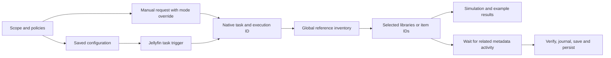

# Execution and scope

JellyP uses Jellyfin's existing scheduler. It does not install another process,
filesystem watcher, patched saver or production database writer.

## Responsibility boundaries

- **Configuration** owns explicit scope, category policies, storage budgets and
  scheduled processing mode. `legacy` preserves old item/global settings; new
  library selections are fail-closed, including deleted library IDs.
- **JellyfinArtworkStore** maps native virtual libraries to physical folder IDs,
  resolves descendants and credited people, inventories references globally and
  saves through native providers/persistence APIs. It contains host-specific query
  and conflict rules; the core never accepts filesystem paths from clients.
- **OptimizationCoordinator** serializes execution, snapshots settings, exposes
  states and counters, waits at transaction boundaries and owns durable image
  journals, recovery copies and per-mode/context scan cursors.
- **Scheduled tasks** keep permanent native keys and delegate execution. Manual
  requests use the same task manager with an execution-specific mode override.
  Their receipt includes task/execution IDs; missing/busy dispatch is explicit.
  Native optimize/synchronize triggers wait cancelably for one another without
  replacing the active report or consuming the other task's pending request.
- **Administrator API/UI** requests manual simulation/application or explicit
  restoration/retirement. Manual mode never rewrites scheduled authorization.
  Permanent storage settings still require explicit user acknowledgment.

## State and durability

One JellyP request/operation is active or pending at a time. A queued request
captures settings and has an execution ID. Progress distinguishes Queued,
Preparing, Inventory, WaitingForMetadata, Processing, Completed, Cancelled and
Failed; restoration and retirement have their own phases. Simulation counts
images that would convert and keeps a path-free sample of at most 20 results.
Inventory publishes inspected-item counts after each hydration batch.

The pending request is in memory, matching native task dispatch. It is not a
persistent job queue and is lost on server restart. Durable image journals and
context-bound preview/apply/synchronization cursors preserve committed work and
recovery. A later native trigger resumes the pass; uncertain image transactions
block applying until recovered. Cancellation is honored between transactions and
while waiting, never by interrupting an in-progress save/persistence sequence.

## Concurrency limits

A full scan blocks writes. Refresh checks concern the target, its parent/owner
chain and its library; unrelated queued metadata and scheduled jobs are allowed.
The wait continues until the conflict clears or native cancellation/runtime limits
apply. The public provider APIs expose queued IDs and active progress but no shared
mutation lock for a plugin transaction. Rechecks plus source/destination hashes
and recovery copies limit risk; they cannot make concurrent manual uploads atomic.

Global reference inventory remains necessary even for one selected library. It
captures scalar IDs once, hydrates 500 at a time and counts every local reference
before filtering candidates. Restricting that reference count to selected libraries
would allow deletion of artwork used outside the scope. People are global entities;
library scope includes credited people, not independent copies per library.

The advanced per-execution image limit bounds work. It is independent of library
selection. Subsequent triggers resume the pass, so the UI does not need to model
libraries as a manually curated sequence of batches.
